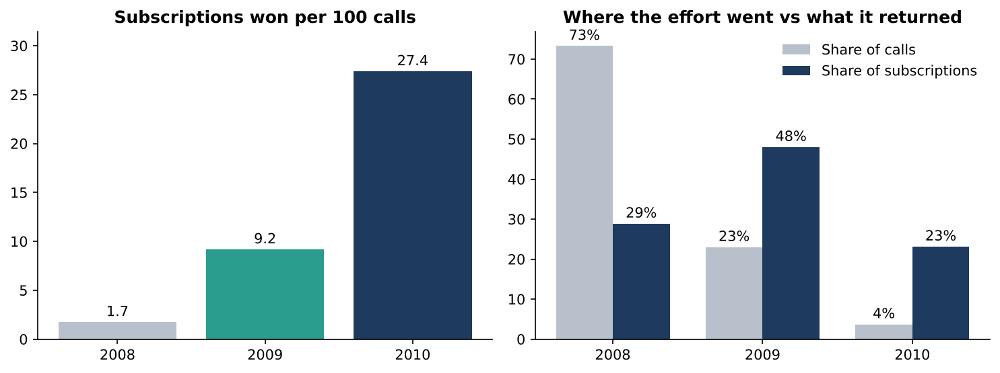
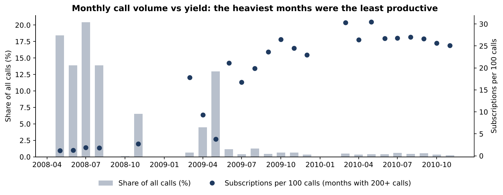
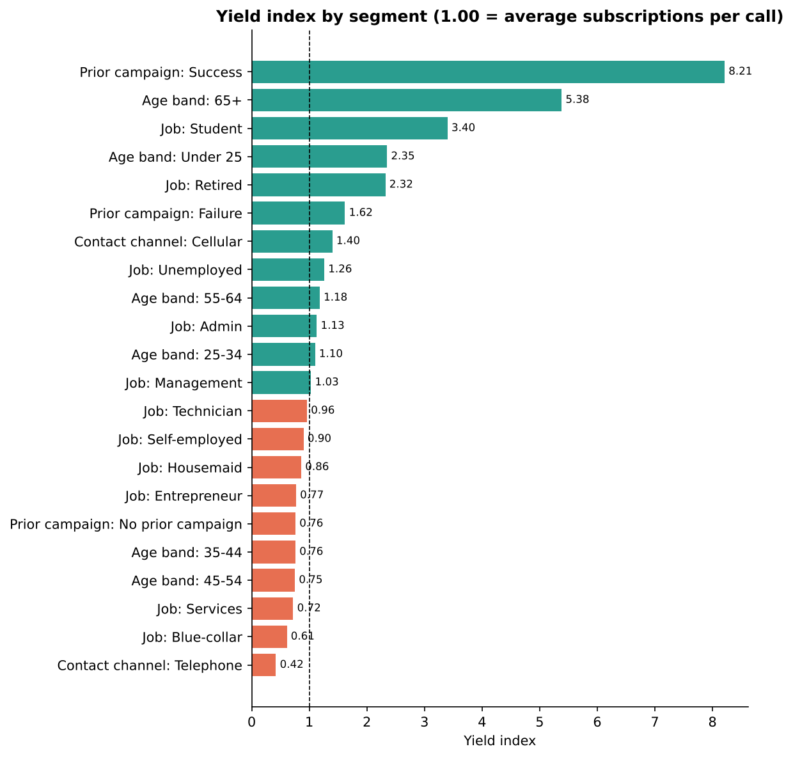
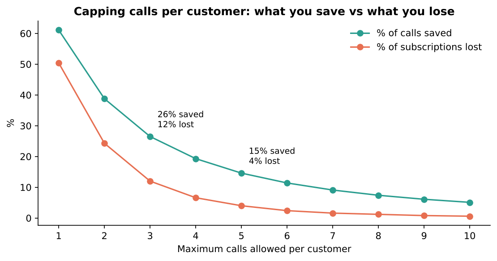
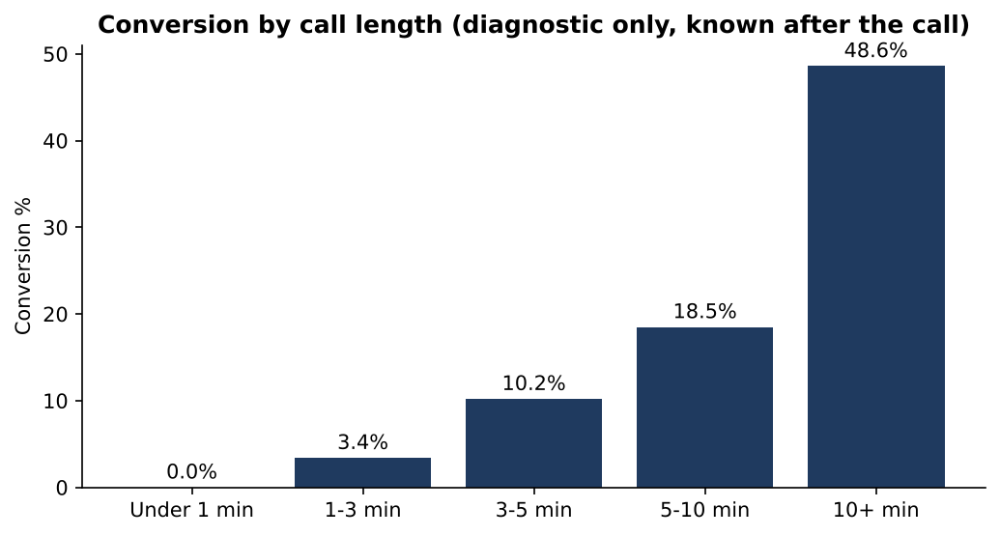

# Bank Term-Deposit Campaign: Where Should the Next Call Go?

**SQL (cleaning & analysis) · Power BI (dashboard) · Python (pipeline & charts)**

A retail bank spent **105,735 phone calls and ~2,955 hours of talk time** to sell term deposits and won **4,639 subscriptions**. This project asks a practical question: *with limited call-centre capacity, where is calling effort wasted, and how should it be redirected to win more subscriptions per call?*

---

## 1. The business question

> **A call centre can only make so many calls. Which customers, channels and calling habits deliver the most term-deposit subscriptions per call, and where is effort being wasted?**

Broken into five sub-questions:

1. Did campaign productivity change over time, and by how much?
2. Which customer segments give the best return per call?
3. How many calls to the same customer is too many?
4. Is the best contact channel obvious?
5. What does call length tell us (and what must it *not* be used for)?

**Success metric used throughout: subscriptions per 100 calls** (not per customer), because calls, not customers, are what the call centre pays for.

## 2. The data

| | |
|---|---|
| Source | UCI *Bank Marketing* dataset (`bank-additional-full`), telemarketing campaigns of a Portuguese bank, **May 2008 to Nov 2010**. Moro, Cortez & Rita (2014), *A Data-Driven Approach to Predict the Success of Bank Telemarketing*, Decision Support Systems. Licence: CC BY 4.0. |
| Size | 41,188 rows x 21 columns (one row per customer contacted) |
| Outcome | `y`: did the customer subscribe to a term deposit? (11.3% did) |
| Note | The copy in `data/raw/` was downloaded from a public GitHub mirror of the UCI file. Check it against the UCI original if you re-use it. |

## 3. What I did to the data (SQL)

The full pipeline is in [`sql/`](sql/) and runs end-to-end with `python scripts/build_database.py`.

| Step | File | What happens |
|---|---|---|
| 1 | `01_staging.sql` | Land the raw file untouched (all text) so every figure can be reconciled to the source |
| 2 | `02_clean_transform.sql` | Deduplicate, cast types, relabel codes, build derived fields |
| 3 | `03_data_quality_checks.sql` | 10 assertion queries; all pass |
| 4 | `04_analysis_tables.sql` | Report tables that answer each question, exported as CSV for Power BI |

**Cleaning decisions (and why):**

- **12 exact duplicate rows removed** (41,188 to 41,176). Immaterial (0.03%), but documented.
- **"unknown" kept as its own category, not imputed.** 20.9% of customers have an unknown credit-default status; guessing would be inventing data.
- **No date column existed.** The file is in chronological order, so I rebuilt the campaign year by detecting where the month number wraps (Dec to Mar). Result: May 2008 to Nov 2010 across 26 campaign months, matching the period stated in the dataset description.
- **`pdays = 999` is a code, not 999 days.** It was set to NULL.
- **Data-quality catch:** 4,110 customers have a prior-campaign outcome of "failure" but `pdays = 999`. Using `pdays` alone to flag "previously contacted" would silently misclassify them, so the flag is built from `previous_contacts > 0`, which is consistent with the outcome field in every row.
- **Call duration is not used to target.** It is only known *after* the call ends, so using it to decide who to call would be circular (data leakage). It is used for diagnosis only.

## 4. What I found



### Finding 1: Most of the effort went to the least productive period
2008 absorbed **73% of all calls but produced 29% of subscriptions**: 1.7 subscriptions per 100 calls, against 9.2 in 2009 and 27.4 in 2010. Talk time per subscription fell from **1.45 hours (2008) to 0.16 hours (2010)**.

I tested whether this is just a different customer mix. Holding the customer type constant (age 25-54, no prior campaign, reached on a mobile), conversion was **5.8% in 2008 vs 19.8% in 2009-10, about 3.4x higher**. So the shift is not only "better customers". The data cannot say whether the cause was the economy (rates fell sharply from late 2008), a change in how the bank ran the campaign, or both; see limitations.



### Finding 2: Past successes are the best calls on the list, and they were barely called
Customers who subscribed in an earlier campaign converted at **65.1%** (95% CI 62.6-67.6%). They made up just **2.4% of calls but 19.3% of subscriptions**, a yield **8.2x** the average. Past "failures" still converted at 14.2% vs 8.8% for customers with no history.



### Finding 3: Cellular beats landline by a wide margin
Cellular calls converted at 14.7% vs 5.2% for landline: **6.1 vs 1.8 subscriptions per 100 calls**. Cellular delivered 83% of subscriptions from 59% of calls.

### Finding 4: Some segments are over-called, others under-called
- **Under-called, high yield:** customers aged 65+ (47.3% conversion, only 1.3% of calls), students (31.4%), retirees (25.3%), under-25s (24.0%).
- **Over-called, low yield:** blue-collar customers took **22.4% of calls for 13.8% of subscriptions** (yield index 0.61); services workers also sit well below average (0.72).
- Education and housing-loan status matter much less. Weekday differences are small.

### Finding 5: Repeated calling hits sharply diminishing returns



Customers who needed **11 or more calls** consumed **13.3% of all calls and delivered 0.6% of subscriptions** (3.1% conversion). Simulating a cap on calls per customer:

| Cap | Calls saved | Subscriptions lost |
|---|---|---|
| 3 calls | 26.5% (28,043) | 12.0% (555) |
| **5 calls** | **14.6% (15,425)** | **4.0% (186)** |
| 7 calls | 9.1% | 1.6% |

### Finding 6: Call length is a result, not a lever
Calls under one minute almost never converted (1 in 4,179); calls over 10 minutes converted 48.6%. That is because interested customers talk longer, not because long calls cause sales. It is useful for coaching (how early do conversations die?) but **must not be used to pick who to call**.



## 5. What I would recommend

| # | Recommendation | Evidence |
|---|---|---|
| 1 | **Call past successes first** and build the list around them | 65% conversion; 8.2x average yield; only 2.4% of calls |
| 2 | **Default to cellular**; treat landline as a fallback, not a primary channel | 6.1 vs 1.8 subscriptions per 100 calls |
| 3 | **Cap calls at about 5 per customer** and redeploy the freed calls | Saves 15,425 calls for 186 subscriptions lost. Even at the campaign's *average* yield (4.4 per 100 calls), those calls would win ~680, a net gain of ~490 subscriptions. (Illustrative; assumes freed calls reach comparable prospects.) |
| 4 | **Shift calls toward 65+, students, retirees and under-25s**; reduce the share going to blue-collar and services lists | Yield indices 2.3x-5.4x vs 0.6x-0.7x |
| 5 | **Stop large-volume, low-yield bursts**: review why the 2008 campaign ran at 1.7 subscriptions per 100 calls before repeating it | 73% of calls, 29% of subscriptions |
| 6 | **Track subscriptions per 100 calls monthly**, with a confidence interval, as the standing KPI | Replaces conversion-per-customer, which hides wasted repeat calls |

## 6. Limitations (read these before quoting any number)

- **Observational data, not an experiment.** Segments differ in many ways at once; "retired customers convert more" does not mean retirement *causes* subscription.
- **Year and economy are tangled together.** Low rates, the 2008-09 crisis and the bank's campaign design all changed at the same time, and the data cannot separate them. The like-for-like test rules out customer mix as the only explanation, nothing more.
- **Segments overlap** (a student is also young and probably cellular). The yield indices are not additive.
- **The call-cap simulation is a first approximation.** It assumes a subscriber's last call is the converting call and that nobody would have behaved differently under a cap.
- **One Portuguese bank, 2008-2010.** Rates, products and customer behaviour have changed since.
- **No cost data.** Everything is measured in calls and talk time, not currency.
- **Descriptive analysis only.** No predictive model; no train/test validation was done.

## 7. What I would do next
1. Fit a propensity model **without** call duration, validated on a time-based hold-out, to score customers rather than rank segments.
2. Get the campaign-design history (scripts, list rules, offers) to separate strategy from economy.
3. Add call costs to convert yield into cost per subscription.

## 8. Dashboard (Power BI)

The report is built from the CSVs in `data/processed/`. Steps, DAX measures and page layouts are in [`powerbi/`](powerbi/):

- `BUILD_GUIDE.md` : model, pages, and a checklist of numbers the report should reproduce
- `measures.dax` : all measures, including confidence intervals and the call-cap what-if
- `theme.json` : colour theme

> _Add your Power BI screenshots here, e.g. ``_

## 9. Repository layout
```
data/raw/            original file, untouched
data/processed/      clean fact table, calendar, report tables (Power BI inputs)
sql/                 01 staging, 02 cleaning, 03 quality checks, 04 analysis tables
scripts/             build_database.py (pipeline), make_charts.py (README charts)
powerbi/             DAX measures, theme, build guide (+ your .pbix)
images/              charts and dashboard screenshots
docs/                data dictionary
```

## 10. Reproduce it
```bash
pip install -r requirements.txt
python scripts/build_database.py    # raw CSV -> SQLite -> clean tables -> CSVs
python scripts/make_charts.py       # README charts
```
The SQL is written for SQLite. To run it on **SQL Server**, replace `printf('%02d', x)` with `FORMAT(x,'00')`, `CREATE TABLE ... AS SELECT` with `SELECT ... INTO`, `MAX(a, b)` with `IIF(a > b, a, b)`, and load the CSV with `BULK INSERT`. On PostgreSQL, use `LPAD`, `GREATEST` and `COPY`.

## Author
**Katlego Kgotlabeng**: final-year BCom Statistics student, North-West University.
